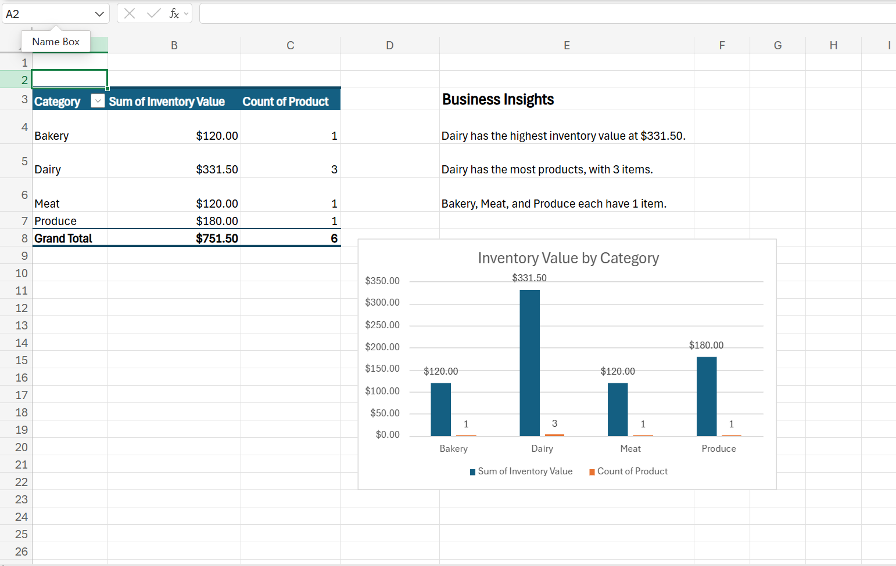

# Retail Inventory Analysis – Excel

## Project Overview
This project uses Microsoft Excel to organize, clean, and analyze a sample retail inventory dataset.

## Skills Demonstrated
- Data entry and organization
- Data cleaning and duplicate removal
- Handling missing values
- Text cleaning using TRIM()
- Sorting and filtering
- Data Validation and dropdown lists
- Excel formulas: SUM, AVERAGE, MAX, MIN, and SUMIF
- PivotTables and PivotCharts
- Basic business insights

## Key Findings
- Total inventory value: $751.50
- Highest inventory category: Dairy ($331.50)
- Highest-value product: Apples ($180.00)
- Lowest-value product: Eggs ($99.00)

## Tools Used
- Microsoft Excel Online

## Purpose
To demonstrate beginner-level Excel skills through a practical retail inventory analysis project.

## Project Screenshot

